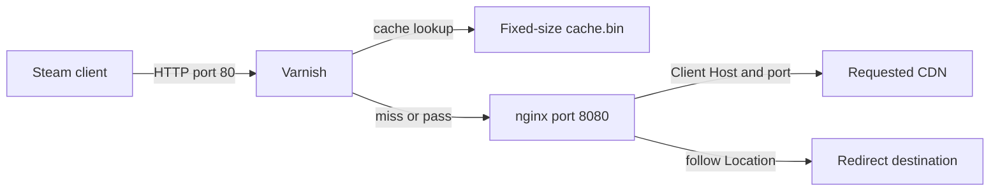

# Steam cache with Varnish and nginx

This directory builds two images from one Dockerfile. Varnish owns the cache;
nginx fetches from the client's HTTP `Host` (including an optional port) and
follows redirects. nginx has no cache or slice module configured.



Only Varnish's HTTP listener is published. The deployment does not change DNS;
configure your client-facing DNS separately:

```text
lancache.steamcontent.com A <CACHE_SERVER_LAN_IP>
```

Steam uses that name to discover a LAN cache, then sends the selected CDN
hostname in `Host`. The proxy preserves that header and resolves the hostname
through `UPSTREAM_DNS`. For example, `Host: cache1.example.com:8081` fetches
`http://cache1.example.com:8081` with the original path and query string.
Different upstream hosts and ports have separate cache entries.

The discovery hostname does not identify a CDN for downloading content. Use the
actual CDN Host for content requests; the probe endpoints below work with the
discovery hostname or any other Host without contacting an upstream.

## Run

```sh
cd steam-varnish
cp .env.example .env
# Set CACHE_DIR and CACHE_SIZE in .env for the target disk.
docker compose up -d --build --wait
```

The initial start **allocates the full configured file size**. The default is
100 GiB at `./cache/cache.bin`; it is not a sparse capacity promise. The host
filesystem must support `posix_fallocate` and have enough free space. Deployment
fails immediately if allocation fails.

To build images without starting or allocating storage:

```sh
docker compose build
```

The image targets can also be built independently:

```sh
docker build --target varnish -t steam-lancache-varnish:local .
docker build --target nginx -t steam-lancache-nginx:local .
```

## Configuration

| Variable | Default | Meaning |
| --- | --- | --- |
| `LISTEN_ADDRESS` | `0.0.0.0` | Host interface for client HTTP requests |
| `HTTP_PORT` | `80` | Published HTTP port; Steam discovery expects port 80 |
| `CACHE_DIR` | `./cache` | Host directory containing `cache.bin` |
| `CACHE_SIZE` | `100G` | Fixed file size; binary K/M/G/T suffixes or bytes |
| `TRANSIENT_SIZE` | `256M` | Separate RAM storage limit for passed/uncacheable responses |
| `CACHE_TTL_SECONDS` | `2592000` | Lifetime of cached immutable chunks: 30 days |
| `UPSTREAM_DNS` | `1.1.1.1 1.0.0.1` | IPv4 DNS resolvers used by nginx, including redirected hosts |
| `MAX_REDIRECTS` | `5` | Maximum followed redirects, between 0 and 8 |

Keep the upstream DNS answers for origin and redirect destinations pointing at
the actual CDN, rather than the cache. Initial requests use HTTP; redirects can
switch to HTTPS. DNS is refreshed by nginx with a 60-second validity.
The previous `UPSTREAM_HOST`, `UPSTREAM_ADDRESS`, and `UPSTREAM_SCHEME` overrides
have been removed; delete them from existing `.env` files.

## LANCache probe

`GET` or `HEAD /lancache-heartbeat` returns an empty `204 No Content`, with:

```text
X-LanCache-Processed-By: <container hostname>
Access-Control-Allow-Origin: *
Access-Control-Expose-Headers: *
Cache-Control: no-store
```

The response is local, bypasses the cache and DNS lookup, and also works with a
query string. `/_health` and `/server-status` continue to return local `200 OK`.

```sh
curl -i http://127.0.0.1/lancache-heartbeat
```

## Cache behavior

- Only successful full `200` responses for `/depot/<id>/chunk/<hex-hash>` are
  cached. These Steam chunks are already relatively small, content-addressed
  objects, so this stack does not divide them into nginx slices.
- A cold `Range` or `HEAD` request fetches a complete chunk with `GET` and no
  upstream Range header. Varnish serves the requested range or headers and keeps
  the complete object for subsequent requests. Filling a chunk can therefore
  download more bytes than a client's individual range requests.
- Simultaneous cache misses for the same object collapse into one upstream fetch.
- The cache key includes the original **Host (with port), path, and query
  string**. The final redirect URL does not become the cache key.
- Manifests and other paths pass through uncached; their Range headers are
  preserved. Requests containing Authorization or Cookie also pass through.
- Responses with Set-Cookie, `Vary: *`, or Cache-Control `private`, `no-store`, or
  `no-cache` are not cached. Errors, redirects, and upstream `206` responses are
  not cached as complete objects. Varnish rejects an unsolicited `206` on a
  full-object fetch with 503; it never mistakes those partial bytes for a chunk.
- `/_health` and `/server-status` return a local `200 OK`. Only GET and HEAD are
  supported. `X-Cache` identifies `MISS`, `HIT`, or `PASS` on proxied responses.

The standard Varnish **file backend starts cold after every daemon/container
restart**. The file remains allocated, but cached objects are not recovered.
This is intentional. The file size limits cache storage, not total process RAM:
Varnish also uses memory for object metadata, worker threads, transient traffic,
and the operating system's page cache. Its working files live in a separate
256 MiB executable tmpfs, not in the game cache file.

To change `CACHE_SIZE`, stop the stack, remove only the disposable
`cache.bin` in your configured `CACHE_DIR`, change `.env`, and start again. A
size mismatch is rejected rather than silently resizing an existing file.
Use a separate cache directory per instance.

## Redirect behavior

nginx handles 301, 302, 303, 307, and 308. A small Lua rewrite handler resolves
absolute, scheme-relative, path-relative, and query-only Location values. The
native nginx proxy streams the final body; Lua never buffers game data.

Relative redirects keep the client's original Host. A redirect to a different
authority or scheme uses the new destination's Host and TLS name and drops
Authorization and Cookie. HTTPS certificates are verified against the image's
CA bundle. The final response retains status, Content-Range, ETag, and the body.
Missing/unsupported Location values and exhausted redirect limits return 502.
`X-Upstream-Redirects` reports the number followed for that object fetch (and is
retained with a cached response).

Unlike the existing monolithic configuration, redirect chasing is bounded and
works across multiple hops, including relative URLs. Both initial and redirect
fetches remain uncached inside nginx.

## Inspect and test

```sh
docker compose ps
docker compose logs nginx varnish
docker compose exec varnish varnishstat -n /var/lib/varnish -1
docker compose exec varnish varnishlog -n /var/lib/varnish -g request
```

For a real game, repeat a request for a valid chunk path observed in the Steam
client's `logs/content_log.txt` or the nginx access log. The first fetch should
show `X-Cache: MISS`, the second `X-Cache: HIT`. Local health checks only verify
the services, not external CDN availability or access to a particular depot.

The nginx backend address is resolved by Varnish at startup. Compose restarts
Varnish when explicitly updating its nginx dependency. If nginx is recreated
outside this Compose workflow with a new IP, restart Varnish as well.

Run the isolated integration suite:

```sh
sh tests/run.sh
```

It builds the actual images, starts local HTTP/HTTPS origins, allocates a 64 MiB
test cache, and checks full and range hits, HEAD fills, client-selected hosts and
ports, separation of cache entries between origins, local LANCache probes, multi-hop
redirects, TLS verification (including rejection of a wrong certificate name),
query preservation, pass behavior, concurrent miss coalescing, truncated-body
recovery, eviction at capacity, file allocation, and cold restarts. No host ports
are published and the disposable test containers and volume are removed on exit. The test CA and
private key are generated into test image stages only.

Production images use Debian trixie's nginx and Varnish packages, including
Debian security updates when rebuilt. No tests against an authenticated Steam
account or a full client game download are implied by the local integration
suite.

References: [Varnish storage backends](https://www.varnish.org/docs/users-guide/storage-backends/),
[nginx error handling](https://nginx.org/en/docs/http/ngx_http_core_module.html#error_page),
[Steam LANCache discovery](https://lancache.net/news/2020/01/14/steam-client-now-supports-lancache/).
